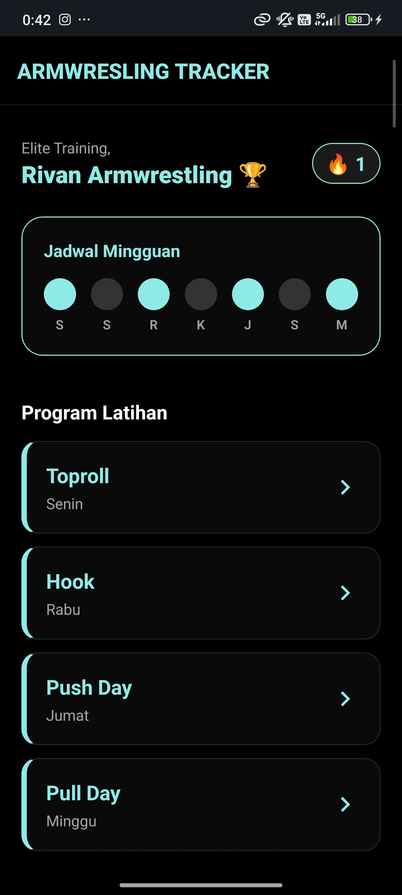
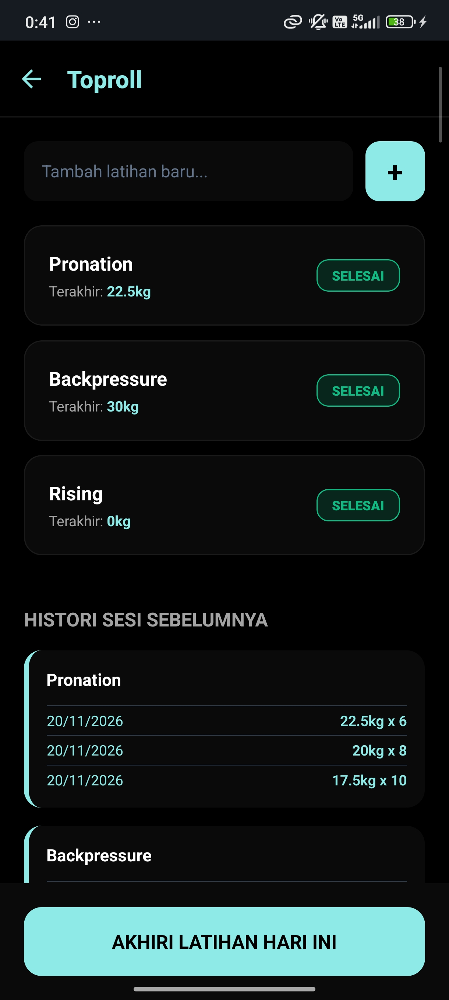
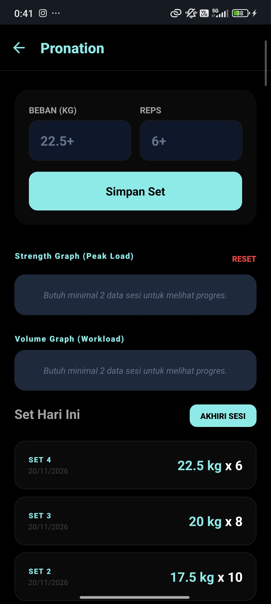

# Armwrestling Tracker

Aplikasi mobile untuk mencatat latihan armwrestling: jadwal mingguan, beban dan repetisi tiap set, riwayat sesi, dan progres dari waktu ke waktu.

> **Status: masih dalam tahap pengembangan.** Fitur dan tampilan masih bisa berubah.

## Tampilan

<p align="center">
  
  
  
</p>

## Fitur

- Jadwal mingguan dan empat program latihan: Toproll, Hook, Push Day, dan Pull Day
- Tambah latihan baru di tiap program
- Catat set (beban dan repetisi), lalu akhiri sesi untuk menyimpannya ke riwayat
- Riwayat sesi sebelumnya untuk tiap latihan
- Grafik progres beban puncak (Strength) dan volume latihan (Workload), muncul setelah minimal dua sesi tercatat
- Streak: hitungan hari latihan berturut-turut
- Data tersimpan di HP, jadi aplikasi tetap bisa dipakai tanpa internet

## Menjalankan di komputer sendiri

Butuh Node.js di komputer dan aplikasi **Expo Go** di HP.

```bash
git clone https://github.com/rivanfathur-rgb/armwrestling-tracker.git
cd armwrestling-tracker
npm install
npx expo start
```

Lalu scan kode QR yang muncul di terminal memakai Expo Go.

## Teknologi

React Native, Expo, TypeScript, Zustand (state management), AsyncStorage (penyimpanan lokal)

## Struktur

- `App.tsx`: titik masuk aplikasi
- `src/screens`: layar beranda, detail program, dan detail latihan
- `src/components`: komponen tampilan (kartu program, input set, grafik progres)
- `src/navigation`: navigasi antar layar
- `src/store`: state aplikasi dan penyimpanan data latihan
- `src/types`: definisi tipe data

## Pembuat

Muhammad Rivan Fathurozin ([@rivanfathur-rgb](https://github.com/rivanfathur-rgb))
